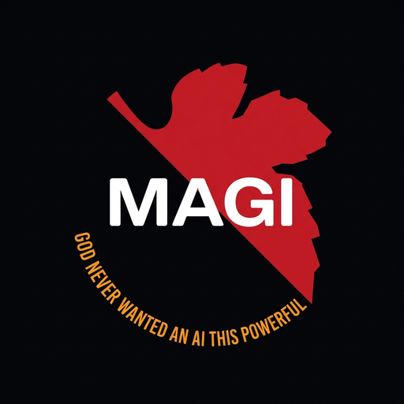
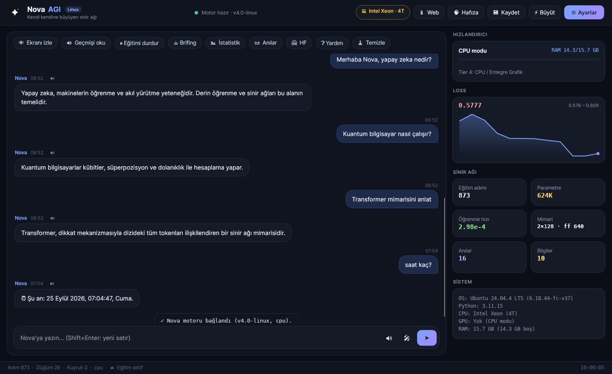

<div align="right">
  <strong>Languages:</strong> <b>English</b> | <a href="README.tr.md">Türkçe</a>
</div>

<div align="center">



# Nova AGI — macOS Edition

*A self-growing neural network with memory, voice, screen awareness and a native Mac app.*

[-black?style=for-the-badge&logo=apple&logoColor=white)](#quick-start)
[](https://www.python.org/)
[](https://pytorch.org/)
[](https://avaloniaui.net/)
[](LICENSE)



</div>

> [!NOTE]
> **Project status: archived.** *"The AI can be trained; I just don't have enough resources."*
> Nova is a working prototype — the architecture, growth, memory and interfaces all run — but training a
> useful language model from scratch needs far more compute than a desktop PC. Expect gibberish from an
> untrained model; tool answers (Wikipedia, calculator, time, screen analysis…) work immediately.

This branch (`mac-version`) is the **macOS port of the Linux edition** (`claude-verison`). Every Linux-only
piece (CUDA/ROCm/XPU, `/proc`, PipeWire, espeak-ng, grim, `wpctl`, `loginctl`, `xdotool`, `.desktop` files)
has been replaced with its macOS equivalent, and the GPU of Apple Silicon is used through **Metal (MPS)**.

## Quick start

```bash
git clone -b mac-version https://github.com/lonlyexe0/NovaAGI.git
cd NovaAGI
./install.sh --with-dotnet   # Python venv, PyTorch (Metal), Homebrew extras, Nova AGI.app
./nova.sh                    # launch (or open "Nova AGI" from Launchpad / Spotlight)
```

Requirements: a Mac with **Apple Silicon (M1 or later)**, macOS 13+, Python 3.10+ (`brew install python`).
Intel Macs work too, but on the CPU only.

`install.sh` options:

| Flag | Effect |
|---|---|
| *(none)* | Homebrew extras (asks first), venv, PyTorch, voice/control/OCR bridges, the app if .NET is present |
| `--minimal` | Core only — **smallest download (~155 MB)**: no speech recognition, mouse control or OCR |
| `--no-brew` | Skip Homebrew packages (`portaudio`, `tesseract`, `tesseract-lang`, `python-tk`) |
| `--with-dotnet` | Install the .NET SDK (`brew install dotnet`) so `Nova AGI.app` can be built |
| `--no-desktop` | Do not build / install the app |
| `--extras=vision,data,export`, `--full` | Heavy optional groups (OpenCV, Hugging Face `datasets`, ONNX) |
| `-y` | Do not ask |

PyTorch for macOS is a single ~130 MB package that already contains Metal support. The installer deletes
the C++ headers and test binaries Nova never loads (`--keep-torch-dev` keeps them).

| Command | What it does |
|---|---|
| `./nova.sh` | Opens `Nova AGI.app` (falls back to the Tk UI if it is not built) |
| `./nova.sh term` | Terminal chat (`main.py`) |
| `./nova.sh launcher` | Advanced terminal launcher with Hugging Face streaming |
| `./nova.sh web` | Web/phone server, prints the access link |
| `./nova.sh tunnel` | Exposes the web server through a Cloudflare tunnel |
| `./nova.sh doctor` | GPU, tool, Python package and macOS permission check |
| `./nova.sh permissions` | Opens the Privacy & Security pages Nova needs |
| `./nova.sh build` | Rebuild `Nova AGI.app` and install it to `~/Applications` |
| `./uninstall.sh` | Remove the app, builds and (optionally) data |

## The Mac app

`packaging/build_app.sh` turns the Avalonia UI into a real **`Nova AGI.app`**: self-contained .NET runtime
(no .NET needed to run it), `.icns` icon, `Info.plist` with permission descriptions, a native menu
(**⌘,** opens Settings) and an ad-hoc code signature. It is installed to `~/Applications`, so it shows up in
Launchpad and Spotlight and can be kept in the Dock.

The Python engine stays in the project folder; the app finds it through
`Nova AGI.app/Contents/Resources/nova_home`. If you move the project, run `./nova.sh build` again.

## macOS permissions

macOS asks once per feature. Grant them in **System Settings › Privacy & Security** (or run
`./nova.sh permissions`). Without them Nova keeps working and tells you which switch to turn on.

| Permission | Needed for |
|---|---|
| Screen & System Audio Recording | `!watch`, screen analysis, phone screen view |
| Accessibility | Mouse/keyboard control, window titles, ⌃⌘Q screen lock |
| Microphone | Voice commands (needs `brew install portaudio`) |
| Automation (System Events) | Show desktop, window titles |

Permissions belong to the app that starts Nova: `Nova AGI.app`, or your terminal when you use
`./nova.sh term`. The app is signed ad-hoc, so macOS may ask again after a rebuild.

## Performance on Apple Silicon

Measured on an M5 (10-core GPU, 16 GB), batch 48 × 256 tokens:

| Model size | CPU train step | Metal train step | Metal generation |
|---|---|---|---|
| Initial (128 × 2 layers) | 145 ms | **56 ms** | ~1,100 tokens/s |
| Grown (384 × 8 layers) | 1,565 ms | **563 ms** | ~500 tokens/s |

Training is ~2.7× faster on the GPU, so `auto` picks Metal. The first reply after start-up is slower
(about a second) while Metal compiles its kernels. Choose **Settings → Hardware → CPU only** to keep the
GPU idle.

## What changed from the Linux version

- **GPU:** CUDA / ROCm / XPU → **Metal (MPS)** with CPU fallback for missing ops
  (`PYTORCH_ENABLE_MPS_FALLBACK=1`), fused AdamW, unified-memory telemetry and training tiers.
- **Hardware detection:** `/proc`, `lspci`, `nvidia-smi` → `sysctl`, `ioreg`, `psutil`. CPU threads are
  pinned to the performance cores.
- **Audio:** PipeWire/PulseAudio → `afplay`; offline voice espeak-ng → **`say`** (Yelda for Turkish,
  Moira for English). Neural edge-tts voices are unchanged.
- **Screen:** grim / gnome-screenshot → `mss` (CoreGraphics) / `screencapture`, with Screen Recording
  permission checks.
- **System actions:** `wpctl`/`loginctl`/`wmctrl` → AppleScript volume control, ⌃⌘Q /
  `pmset displaysleepnow`, hide-all-apps, Activity Monitor; `xdg-open` → `open` / `open -a`.
- **Keyboard:** shortcuts written as `ctrl+c` are sent as ⌘C (use `ctrlleft` for a real Control key);
  clipboard uses `pbcopy`. Screenshot crops convert Retina pixels to mouse points.
- **Data** lives in `~/Library/Application Support/NovaAGI` (`NOVA_DATA_DIR` still overrides it).
- **Scripts:** `install.sh` / `nova.sh` run on the bash 3.2 that ships with macOS; Homebrew replaces
  apt/dnf/pacman; a `.app` bundle replaces the `.desktop` entry.

## Phone and web access

Turn it on in **Settings → Mobile & Web** (or run `./nova.sh web`). The app shows a link like
`http://192.168.1.20:8080/?token=…`. Open it on a device on the same Wi-Fi and use **Add to Home Screen**
for an app-like experience. The token is stored on the device after the first visit. For access over
the internet, run `./nova.sh tunnel` and append `?token=…` to the `trycloudflare.com` URL.
macOS may ask once whether Python may accept incoming connections — allow it for phone access.

## Chat commands

`!help` lists everything. Highlights: `!stats`, `!train stop|start`, `!wiki <topic>`, `!search <q>`,
`!python <code>`, `!read <file>`, `!watch` (screen analysis), `!briefing`, `!memories 5`, `!save`,
`!grow`, `!hf <token>`, `!lang en|tr`, `!action lock|mute|vol_up|vol_down|desktop|taskmgr`.

## Project layout

```
nova_engine.py      core engine: chat pipeline, ! commands, telemetry, settings
nova_bridge.py      JSON-lines IPC for the desktop app (stdout = protocol only)
brain.py            self-growing transformer (KV-cache, SDPA, network morphism)
memory.py           SQLite episodic + semantic memory, RAG, graph data
body.py             agent body: web crawler, voice, vision, skills
mac_desktop.py      audio / screenshot / system actions / permissions on macOS
hardware.py         Apple Silicon CPU/GPU/RAM detection and training profile
gpu_setup.py        Metal (MPS) · CPU setup (run before importing torch)
web_server.py       REST API + web app (web/)
NovaApp/            Avalonia desktop app (C#)
packaging/          build_app.sh (Nova AGI.app) · build_release.sh (tar.gz)
main.py · nova_launcher.py · gui.py   terminal REPL, launcher, Tk fallback UI
nova_headless_trainer/                cloud/Colab trainer
```

## Troubleshooting

- **"Nova AGI is damaged / can't be opened":** the app came from a downloaded archive. Run
  `./nova.sh build` (it clears the quarantine flag and re-signs), or right-click → Open.
- **The app says the engine could not start:** run `./install.sh` in the project folder, then
  `./nova.sh build` if you moved the folder.
- **Screen analysis returns nothing:** grant Screen Recording to Nova AGI (or your terminal) and restart Nova.
- **No microphone input:** `brew install portaudio`, then `./install.sh` (installs `pyaudio`), and allow
  the microphone when macOS asks.
- **Tk UI does not open:** `brew install python-tk@3.x` (same version as `python3 --version`).
- **Metal problems:** choose CPU in Settings, or start with `NOVA_DEVICE=cpu ./nova.sh term`.

## License

GPL-3.0 — see [LICENSE](LICENSE).
