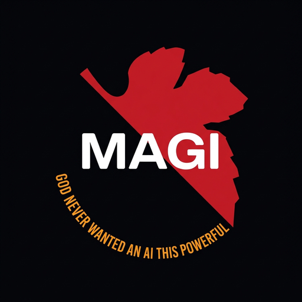
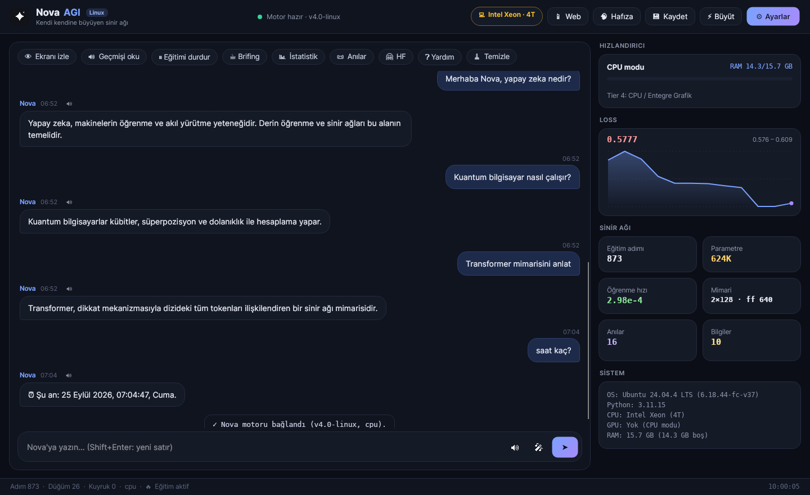

<div align="right">
  <strong>Diller:</strong> <a href="README.md">English</a> | <b>Türkçe</b>
</div>

<div align="center">



# Nova AGI — macOS Sürümü

*Hafızası, sesi, ekran farkındalığı ve yerel Mac uygulaması olan, kendi kendine büyüyen sinir ağı.*

[-black?style=for-the-badge&logo=apple&logoColor=white)](#hızlı-başlangıç)
[](https://www.python.org/)
[](https://pytorch.org/)
[](https://avaloniaui.net/)
[](LICENSE)



</div>

> [!NOTE]
> **Proje durumu: rafa kaldırıldı.** *"Yapay zeka eğitilebilir, sadece elimde yeterince kaynak yok."*
> Nova çalışan bir prototiptir; mimari, büyüme, hafıza ve arayüzlerin hepsi çalışır. Ancak sıfırdan
> kullanışlı bir dil modeli eğitmek bir masaüstü bilgisayarın çok ötesinde işlem gücü ister. Eğitilmemiş
> model anlamsız metin üretir; araç yanıtları (Wikipedia, hesap makinesi, saat, ekran analizi…) hemen çalışır.

Bu dal (`mac-version`), **Linux sürümünün (`claude-verison`) macOS'a çevrilmiş hâlidir**. Linux'a özgü
tüm parçalar (CUDA/ROCm/XPU, `/proc`, PipeWire, espeak-ng, grim, `wpctl`, `loginctl`, `xdotool`, `.desktop`
dosyaları) macOS karşılıklarıyla değiştirildi. Apple Silicon'ın GPU'su **Metal (MPS)** ile kullanılır.

## Hızlı başlangıç

```bash
git clone -b mac-version https://github.com/lonlyexe0/NovaAGI.git
cd NovaAGI
./install.sh --with-dotnet   # Python ortamı, PyTorch (Metal), Homebrew ekleri, Nova AGI.app
./nova.sh                    # başlat (veya Launchpad / Spotlight'tan "Nova AGI")
```

Gereksinimler: **Apple Silicon (M1 ve sonrası)** bir Mac, macOS 13+, Python 3.10+ (`brew install python`).
Intel Mac'lerde de çalışır ama yalnızca CPU ile.

`install.sh` seçenekleri:

| Seçenek | Etkisi |
|---|---|
| *(yok)* | Homebrew ekleri (önce sorar), venv, PyTorch, ses/kontrol/OCR köprüleri, .NET varsa uygulama |
| `--minimal` | Yalnızca çekirdek — **en az indirme (~155 MB)**: ses tanıma, fare kontrolü ve OCR yok |
| `--no-brew` | Homebrew paketlerini atla (`portaudio`, `tesseract`, `tesseract-lang`, `python-tk`) |
| `--with-dotnet` | `Nova AGI.app` derlenebilsin diye .NET SDK'yı kur (`brew install dotnet`) |
| `--no-desktop` | Uygulamayı derleme / kurma |
| `--extras=vision,data,export`, `--full` | Ağır isteğe bağlı gruplar (OpenCV, Hugging Face `datasets`, ONNX) |
| `-y` | Soru sorma |

macOS'ta PyTorch tek bir ~130 MB'lık pakettir ve Metal desteği içinde gelir. Kurulum, Nova'nın hiç
kullanmadığı C++ başlık dosyalarını ve test ikililerini siler (`--keep-torch-dev` korur).

| Komut | Görevi |
|---|---|
| `./nova.sh` | `Nova AGI.app`'i açar (derlenmemişse Tk arayüzü) |
| `./nova.sh term` | Terminal sohbeti (`main.py`) |
| `./nova.sh launcher` | Hugging Face akışlı gelişmiş terminal başlatıcı |
| `./nova.sh web` | Web/telefon sunucusu, erişim adresini yazdırır |
| `./nova.sh tunnel` | Web sunucusunu Cloudflare tüneliyle internete açar |
| `./nova.sh doctor` | GPU, araç, Python paketi ve macOS izin kontrolü |
| `./nova.sh permissions` | Nova'nın ihtiyaç duyduğu Gizlilik ve Güvenlik sayfalarını açar |
| `./nova.sh build` | `Nova AGI.app`'i yeniden derler ve `~/Applications`'a kurar |
| `./uninstall.sh` | Uygulamayı, derlemeleri ve (isteğe bağlı) verileri kaldırır |

## Mac uygulaması

`packaging/build_app.sh`, Avalonia arayüzünü gerçek bir **`Nova AGI.app`** paketine dönüştürür. Paket
kendi .NET çalışma ortamını içerir, yani çalıştırmak için .NET gerekmez. Ayrıca şunlar eklenir:
- `.icns` simgesi
- İzin açıklamalarını içeren `Info.plist`
- Mac menüsü (**⌘,** Ayarları açar)
- Yerel (ad-hoc) imza

Uygulama `~/Applications` klasörüne kurulur. Launchpad'de ve Spotlight'ta görünür, Dock'a eklenebilir.

Python motoru proje klasöründe kalır. Uygulama onu `Nova AGI.app/Contents/Resources/nova_home` dosyası
sayesinde bulur. Proje klasörünü taşırsanız `./nova.sh build` komutunu tekrar çalıştırın.

## macOS izinleri

macOS her özellik için bir kez izin sorar. İzinleri **Sistem Ayarları › Gizlilik ve Güvenlik**
bölümünden verebilirsiniz (veya `./nova.sh permissions`). İzin yoksa Nova çalışmaya devam eder ve
hangi anahtarı açmanız gerektiğini söyler.

| İzin | Ne için |
|---|---|
| Ekran ve Sistem Sesi Kaydı | `!watch`, ekran analizi, telefondan ekran görüntüleme |
| Erişilebilirlik | Fare/klavye kontrolü, pencere başlıkları, ⌃⌘Q ekran kilidi |
| Mikrofon | Sesli komut (`brew install portaudio` gerekir) |
| Otomasyon (System Events) | Masaüstünü göster, pencere başlıkları |

İzinler Nova'yı başlatan uygulamaya verilir: `Nova AGI.app` veya `./nova.sh term` kullanıyorsanız
terminaliniz. Uygulama ad-hoc imzalı olduğu için yeniden derlemeden sonra macOS izni tekrar sorabilir.

## Apple Silicon performansı

M5 (10 çekirdekli GPU, 16 GB), batch 48 × 256 token ile ölçüldü:

| Model boyutu | CPU eğitim adımı | Metal eğitim adımı | Metal üretim |
|---|---|---|---|
| Başlangıç (128 × 2 katman) | 145 ms | **56 ms** | ~1.100 token/sn |
| Büyümüş (384 × 8 katman) | 1.565 ms | **563 ms** | ~500 token/sn |

Eğitim GPU'da yaklaşık 2,7 kat daha hızlı olduğu için `auto` ayarı Metal'i seçer. Açılıştan sonraki ilk
yanıt, Metal çekirdeklerini derlerken yaklaşık bir saniye daha yavaştır. GPU'yu boşta tutmak için
**Ayarlar → Donanım → Yalnızca CPU** seçeneğini kullanın.

## Linux sürümünden farklar

- **GPU:** CUDA / ROCm / XPU yerine **Metal (MPS)**. Metal'de olmayan işlemler CPU'ya düşer
  (`PYTORCH_ENABLE_MPS_FALLBACK=1`). Ayrıca birleşik AdamW (fused), paylaşımlı bellek telemetrisi ve
  Apple Silicon eğitim profilleri eklendi.
- **Donanım algılama:** `/proc`, `lspci`, `nvidia-smi` yerine `sysctl`, `ioreg`, `psutil`. CPU
  thread'leri performans çekirdeklerine göre ayarlanır.
- **Ses:** PipeWire/PulseAudio yerine `afplay`. Çevrimdışı ses espeak-ng yerine **`say`** (Türkçe için
  Yelda, İngilizce için Moira). Nöral edge-tts sesleri aynı kaldı.
- **Ekran:** grim / gnome-screenshot yerine `mss` (CoreGraphics) / `screencapture`, Ekran Kaydı izni
  kontrolüyle birlikte.
- **Sistem eylemleri:** `wpctl`/`loginctl`/`wmctrl` yerine şunlar kullanılıyor:
  - AppleScript ile ses düzeyi
  - ⌃⌘Q / `pmset displaysleepnow` ile kilit
  - Tüm uygulamaları gizleyerek masaüstünü gösterme
  - Etkinlik Monitörü
  - `xdg-open` yerine `open` / `open -a`
- **Klavye:** `ctrl+c` diye yazılan kısayollar ⌘C olarak gönderilir (gerçek Control tuşu için
  `ctrlleft`). Pano için `pbcopy` kullanılır. Ekran kırpma koordinatları Retina piksellerine çevrilir.
- **Veriler** `~/Library/Application Support/NovaAGI` altında tutulur (`NOVA_DATA_DIR` hâlâ geçerli).
- **Betikler:** `install.sh` / `nova.sh` macOS ile gelen bash 3.2'de çalışır. apt/dnf/pacman yerine
  Homebrew, `.desktop` girdisi yerine `.app` paketi kullanılır.

## Telefon ve web erişimi

**Ayarlar → Mobil & Web** bölümünden açın (veya `./nova.sh web`). Uygulama
`http://192.168.1.20:8080/?token=…` gibi bir adres gösterir. Aynı Wi-Fi'deki bir cihazda açıp
**Ana Ekrana Ekle** ile uygulama gibi kullanabilirsiniz. Erişim anahtarı ilk ziyaretten sonra cihazda
saklanır. İnternet üzerinden erişim için `./nova.sh tunnel` çalıştırın ve `trycloudflare.com` adresinin
sonuna `?token=…` ekleyin. macOS, Python'un gelen bağlantıları kabul etmesine izin verip vermediğinizi
bir kez sorabilir. Telefon erişimi için izin verin.

## Sohbet komutları

`!yardim` tüm komutları listeler. Öne çıkanlar: `!istatistik`, `!egitim durdur|baslat`, `!wiki <konu>`,
`!python <kod>`, `!watch` (ekran analizi), `!brifing`, `!kaydet`, `!buyu`, `!hf <token>`, `!lang en|tr`,
`!eylem kilitle|sessiz|ses_artir|ses_azalt|masaustu|gorev_yoneticisi`.

## Proje yapısı

```
nova_engine.py      çekirdek motor: sohbet akışı, ! komutları, telemetri, ayarlar
nova_bridge.py      masaüstü uygulaması için JSON-lines IPC (stdout yalnızca protokol)
brain.py            kendi kendine büyüyen transformer (KV-cache, SDPA, network morphism)
memory.py           SQLite epizodik + semantik hafıza, RAG, graf verisi
body.py             ajan bedeni: web tarayıcı, ses, görüntü, yetenekler
mac_desktop.py      macOS'ta ses / ekran görüntüsü / sistem eylemleri / izinler
hardware.py         Apple Silicon CPU/GPU/RAM algılama ve eğitim profili
gpu_setup.py        Metal (MPS) · CPU hazırlığı (torch'tan önce çalışır)
web_server.py       REST API + web uygulaması (web/)
NovaApp/            Avalonia masaüstü uygulaması (C#)
packaging/          build_app.sh (Nova AGI.app) · build_release.sh (tar.gz)
main.py · nova_launcher.py · gui.py   terminal REPL, başlatıcı, yedek Tk arayüzü
nova_headless_trainer/                bulut/Colab eğitici
```

## Sorun giderme

- **"Nova AGI hasarlı / açılamıyor":** Uygulama indirilen bir arşivden geldiyse olur. `./nova.sh build`
  çalıştırın (karantina işaretini kaldırır ve yeniden imzalar) veya sağ tık → Aç.
- **Uygulama "motor başlatılamadı" diyor:** Proje klasöründe `./install.sh` çalıştırın. Klasörü
  taşıdıysanız ardından `./nova.sh build` çalıştırın.
- **Ekran analizi boş dönüyor:** Nova AGI'ye (veya terminale) Ekran Kaydı izni verin ve Nova'yı
  yeniden başlatın.
- **Mikrofon çalışmıyor:** `brew install portaudio` ardından `./install.sh` (`pyaudio`'yu kurar). macOS
  sorduğunda mikrofona izin verin.
- **Tk arayüzü açılmıyor:** `brew install python-tk@3.x` (`python3 --version` ile aynı sürüm).
- **Metal sorunları:** Ayarlar'dan CPU seçin veya `NOVA_DEVICE=cpu ./nova.sh term` ile başlatın.

## Lisans

GPL-3.0 — bkz. [LICENSE](LICENSE).
